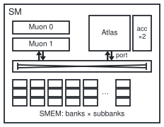
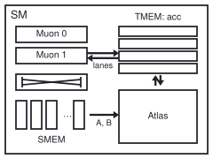

# memarch: the cheapest SM memory that keeps Atlas fed

Question: what is the smallest SRAM area (macros + crossbars + logic) that keeps Atlas
at >= 95% on attention and GEMMs while 2 Muon cores run softmax at the same time?

## The three options

| A: TMEM-fed | B: unified smem | C: Blackwell-like |
|:---:|:---:|:---:|
|  |  |  |

- **A.** Everything Atlas touches is in TMEM. A small smem behind a crossbar serves Muon.
- **B.** One smem holds everything. Atlas keeps only 2 accumulator tiles (32x32 fp32), so partial sums spill to smem.
- **C.** Operands are in smem. Accumulators are in a TMEM of N_acc tiles, and Muon reads that TMEM by lane partition.

## How a design becomes a number

```
knobs ──> capacity ──> macros (count x depth x width) ──> area     (area.py)
  │                                                          
  └────> port bandwidths (B/cycle) ──> r2sim runs the RISC-V kernel ──> utilization
          muonxbar.py: crossbar conflict efficiency for Muon
```

- **Bandwidth sets the macro count.** smem has banks x subbanks macro columns, each `width` bits per cycle. 1R1W: read and write are separate ports.
- **Capacity sets the macro depth.** Each macro holds capacity / columns, rounded up to a power of 2, with a minimum of 0.25 Kbit.
- **Utilization** = useful MACs / (P x simulated cycles). With unlimited memory every kernel reaches about 100%, so any loss is memory.
- A design **passes** if attention and all three GEMMs reach >= 95%.

## Results

These are the cheapest passing designs. GEMM utilization is 100% in every case.

| P, dtype   | A                 | B                     | C                     |
|------------|-------------------|-----------------------|-----------------------|
| 1024, bf16 | 413k µm², 40 mac. | **313k µm², 33 mac.** | 390k µm², 40 mac.     |
| 1024, fp8  | 413k, 40          | 311k, 33              | **239k, 24**          |
| 2048, bf16 | 413k, 40          | **330k, 33**          | 401k, 40              |
| 2048, fp8  | 413k, 40          | 322k, 33              | **243k, 24**          |

What sets the area:
- **Capacity, not bandwidth.** Crossbars and logic are under 2% of the total. Area moves in power-of-two macro steps.
- **bf16: B wins.** It doesn't need C's separate TMEM accumulator.
- **fp8: C wins.** Its operand storage halves, so its smem drops to 16 macros.
- **kc (k per partial sum) decides bf16 attention.** At the same area, kc = 64 drops A, B and C to 58%, 85% and 87%. Partial-sum traffic is the deciding bandwidth.

Main attention stalls (bf16, P = 1024):

| Option | Stalls |
|---|---|
| A | TMEM write port 19%, Muon partition links 8% each |
| B | Muon crossbar links 19% each, smem write port 14% |
| C | smem write port 14%, Muon partition links 14% each |

## Caveats

- The crossbar and logic constants in `params/logic.yaml` are placeholders.
- Arbitration is first-come only.
- HBM is ideal.
- Pending: Muon slowdown versus running alone, and an iso-capacity comparison.

## Files

| File | What it is |
|---|---|
| `params/` | SRAM area table, logic constants |
| `area.py` | Area model |
| `muonxbar.py` | Muon crossbar conflict model |
| `archs.py` | Design knobs, capacities, assumptions |
| `simconfig.py` | Writes the r2sim config |
| `runner.py` | Runs the kernel (`memarch-ws/r2-toolchain/examples/memarch`) |
| `sweep.py` | The sweep; writes `out/sweep.jsonl` |

Command: `python3 sweep.py --out out/sweep.jsonl --jobs 64`
