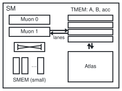
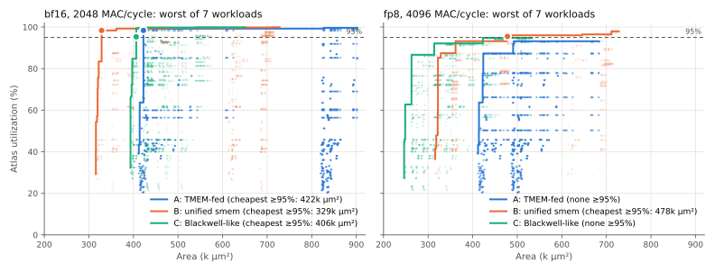

# memarch: the cheapest SM memory that keeps Atlas fed

Question: what is the smallest SRAM area (macros + crossbars + logic) that keeps Atlas
at >= 95% on attention and GEMMs while 2 Muon cores run softmax at the same time?

## The three options

| A: TMEM-fed | B: unified smem | C: Blackwell-like |
|:---:|:---:|:---:|
|  |  |  |

- **A.** Everything Atlas touches is in TMEM. A small smem behind a crossbar serves Muon.
- **B.** One smem holds everything. Atlas keeps only 2 accumulator tiles (32x32 fp32), so partial sums spill to smem.
- **C.** Operands are in smem. Accumulators are in a TMEM of N_acc tiles, and Muon reads that TMEM by lane partition.

## How a design becomes a number

```
knobs ──> capacity ──> macros (count x depth x width) ──> area     (area.py)
  │
  └────> port bandwidths (B/cycle) ──> r2sim runs the RISC-V kernel ──> utilization
          muonxbar.py: crossbar conflict efficiency for Muon
```

- **Bandwidth sets the macro count:** banks x subbanks macros, each `width` bits per cycle (1R1W).
- **Capacity sets the macro depth:** the working set / macros, rounded up to a power of 2.
- **Atlas** is 32x32 PEs: 2048 bf16 or 4096 fp8 MACs per cycle.
- **Utilization** = useful MACs / (MACs per cycle x simulated cycles).
- **Pass rule:** >= 95% on all 7 workloads.

## Workloads

| Workload | What runs |
|---|---|
| Attention | QK^T (Atlas) -> softmax (Muon) -> PV (Atlas), pipelined |
| 3 GEMMs | 1024³, 64x4096x4096, 256x256x8192 |
| Transpose | 512x512x1024 GEMM, while Muon transposes in smem (row read, column write) |
| Gather 4 B | same GEMM, while Muon gathers random words (scatter is identical in this model) |
| Gather 32 B | same GEMM, while Muon gathers random 32 B segments |

In the last three, Muon moves 50% of its ideal port bandwidth (`MUON_LOAD`).

## Results



Cheapest design >= 95% on all 7 workloads:

| | A | B | C |
|---|---|---|---|
| bf16 | 422k µm² | **329k µm²** | 406k µm² |
| fp8 | none (best 93%) | 478k µm² | none (best 94.8%) |

- **bf16:** B is cheapest. Config: 1x32x128b smem (32 macros), full crossbar, XOR swizzle, 256 B/cycle Atlas port, kc 128.
- **fp8:** attention is limited by Muon. Softmax on 2 cores with 64 B/cycle ports can't keep up with 4096 MAC/cycle, so SRAM can't fix it.
- **Knob effects:**
  - No swizzle drops the transpose to 23-46%.
  - Radix 2 instead of a full crossbar drops attention to 71% and gather to 65% (B).
  - kc 64 drops attention to 85%.
- Per-workload plots: `figs/pareto_workloads.svg`. All tables: `out/analysis2.txt` (from `analyze.py`).

## Caveats

- Crossbar and logic constants are placeholders (`params/logic.yaml`).
- Arbitration is first-come only. HBM is ideal.
- Pending: Muon slowdown vs alone, and an iso-capacity comparison.

## Files

| File | What it is |
|---|---|
| `params/` | SRAM area table, logic constants |
| `area.py` | Area model |
| `muonxbar.py` | Muon crossbar conflict model |
| `archs.py` | Design knobs, capacities, assumptions |
| `simconfig.py` | Writes the r2sim config |
| `runner.py` | Runs the kernel (`memarch-ws/r2-toolchain/examples/memarch`) |
| `sweep.py` | The sweep; writes `out/sweep2.jsonl` |
| `analyze.py` | Tables and Pareto plots |

Commands: `python3 sweep.py --out out/sweep2.jsonl --jobs 64`, then `python3 analyze.py out/sweep2.jsonl`
